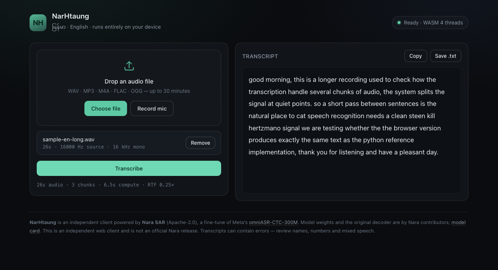

# NarHtaung

**Standalone Burmese + English speech recognition that runs entirely in your browser.** No server, no API key, no audio upload — the model runs on the device with WebAssembly, and the tab works offline once the weights are cached.

[](LICENSE)
[](https://huggingface.co/YeeNyunn/nara-sar)
[](#privacy)



**NarHtaung** — မြန်မာ + English အသံမှ စာသားပြောင်း web app။ အသံဖိုင် server ဆီ လုံးဝ မရောက်ပါ — browser ထဲမှာပဲ မော်ဒယ်ကို run တယ်။ ပထမတစ်ခါ weights (~430 MB) ကို ဒေါင်းပြီးရင် internet မလိုဘဲ သုံးလို့ရတယ်။

## Features

- **100 % client-side** — ONNX Runtime Web (WASM) + a JavaScript port of the original CTC beam decoder. Nothing is uploaded.
- **Burmese, English and mixed speech**, with the model's bilingual character n-gram LM and Burmese structural syllable constraints intact.
- **Offline after first load** — weights are stored in the origin private file system (OPFS); a reload needs zero network requests.
- **File or microphone** — drag & drop WAV/MP3/M4A/FLAC/OGG, or record straight from the mic.
- **No build step** — plain ES modules, one dependency (`onnxruntime-web`), served by a 100-line Node static server.
- **Parity-tested** against the official Python decoder: identical transcripts on every chunk.

## Quick start

```bash
git clone https://github.com/kowinhtike/nar-htaung.git
cd nar-htaung
npm install
npm start            # http://localhost:4173
```

That's it. On first load the client probes `./models/`:

- **models present** → served locally, fastest.
- **models missing** → automatically fetched from the [Hugging Face repo](https://huggingface.co/YeeNyunn/nara-sar) (~430 MB, one time), then cached in the browser.

To keep the weights on your own machine instead:

```bash
bash tools/fetch-model.sh      # ~430 MB into ./models
```

Force a source with a URL parameter: `?source=local` or `?source=hf`.

## Deploy

`npm run build` writes a static bundle to `dist/` — 14 files, ~15 MB. Model weights are **never uploaded**: the browser fetches them from Hugging Face on first load and caches them.

```bash
npm run build
npm run preview      # serve dist/ on :4177 with production headers
```

### Cloudflare Workers (static assets)

`wrangler.toml` uploads `dist/` as a Workers static-assets deployment:

| Setting | Value |
|---|---|
| Build command | `npm run build` |
| Deploy command | `npx wrangler deploy` |

Dashboard: Workers & Pages → Create → Import a repository → pick this repo, then set the two commands above. Or from a laptop:

```bash
npx wrangler login
npm run deploy
```

`dist/_headers` is parsed by Workers, so `Cross-Origin-Opener-Policy` / `Cross-Origin-Embedder-Policy` are applied and multi-threaded WASM works. Every asset is under the 25 MiB per-file limit — the largest is the 14.8 MB ONNX Runtime wasm. First visit downloads ~430 MB from the Hugging Face CDN; later visits load from the browser cache in about a second.

> Deploying with `wrangler deploy` (not `wrangler pages deploy`) is what the Workers build pipeline runs. If you would rather have a Pages project, use build command `npm run build` and output directory `dist` with no deploy command — Pages reads the same `_headers`.

### Other hosts

Any static host works. Two things matter:

1. **COOP/COEP headers** enable `SharedArrayBuffer`, which is what lets WASM run multi-threaded (roughly 3× faster). Without them the app still works, single-threaded.
2. **Large model files** are best left to the Hugging Face CDN (the default when `./models` is absent), since most hosts cap individual file size.

`_headers` (Netlify, Cloudflare) and `vercel.json` are included:

```text
/*
  Cross-Origin-Opener-Policy: same-origin
  Cross-Origin-Embedder-Policy: require-corp
```

GitHub Pages cannot set response headers, so a Pages deployment runs single-threaded (RTF ≈ 0.76× instead of ≈ 0.25× on an M4).

## How it works

```text
audio ──► 16 kHz mono ──► 8–10 s chunks (split at the quietest 200 ms)
      ──► zero-mean / unit-variance ──► INT8 ONNX (acoustic)
      ──► top-10 logits per frame ──► CTC prefix beam search (beam 16, α 0.6)
      ──► bilingual char 6-gram LM + Burmese syllable gate ──► text
```

| File | Role |
|---|---|
| `src/worker.js` | asset loading (OPFS cache), ONNX Runtime Web session, chunk loop |
| `src/decoder.js` | CTC prefix beam search — port of `sar_decoder.py` |
| `src/lm.js` | `NARALM01` character 6-gram LM, binary search over the 84 MB blob |
| `src/syllables.js` | Burmese structural syllable gate — port of `sar_syllables.py` |
| `src/audio.js` | downmix, resample, quiet-point chunking, normalisation |
| `src/app.js`, `index.html`, `styles.css` | UI: drop zone, mic, progress, transcript |
| `server.mjs` | static server with COOP/COEP and immutable caching |
| `tools/reference/` | unmodified Python decoder from the model release (parity oracle) |

The port keeps every decoding constant byte-identical: beam 16, top-k 10, α 0.6, β 0, blank id 0, the same LM container, the same syllable rules. Only the plumbing changed — `mmap` → `ArrayBuffer`, `lru_cache` → capped `Map`, Python `frozenset` states → canonical string keys, `numpy` stable argsort → an insertion top-k with the same tie-break.

## Validation

The JavaScript decoder is checked against the official Python runner on identical input. Reproduce:

```bash
bash tools/make-sample.sh                                   # macOS `say` TTS, or use your own WAV
python tools/dump_reference.py samples/sample-en-long.wav /tmp/ref
node tools/parity.mjs /tmp/ref
```

```
audio 25.51s  chunks(py)=3 chunks(js)=3
PASS  chunk boundaries match
PASS  normalised input matches reference      max|diff|=0.00e+0
PASS  decoder text chunk 0/1/2                identical strings
PASS  end-to-end text chunk 0/1/2             identical strings
```

ONNX Runtime Web's INT8 kernels are not bit-identical to the native ones (frame argmax agrees on 99.5–99.7 % of frames), but the final transcript matched in every test.

## Performance

Apple M4, Chrome, INT8 model:

| Setup | 26 s audio | RTF |
|---|---|---|
| 4 WASM threads (COOP/COEP served) | 6.2 s | 0.24× |
| 1 thread (no cross-origin isolation) | ~20 s | 0.76× |
| Native onnxruntime, 8 threads (reference) | 1.3 s | 0.05× |

First load ~430 MB; reload from OPFS ~0.9 s.

## Browser support

| Browser | Status |
|---|---|
| Chrome / Edge 113+ | tested — threads, OPFS caching, mic |
| Safari 17+ | expected to work (OPFS `createWritable`, WASM); untested |
| Firefox 115+ | expected to work; untested |

Needs WebAssembly SIMD, `OfflineAudioContext.decodeAudioData`, and (for threads) `SharedArrayBuffer`.

## Limitations

- **No timestamps and no streaming.** The model is a complete-utterance CTC model; audio is transcribed chunk by chunk after recording finishes.
- **30 minutes / 256 MB** per file, 8–10 s internal chunks.
- The model release has **no held-out CER/WER benchmark**. Expect errors on names, numbers, accented English and mixed speech. Review transcripts before relying on them.
- INT8 only in the UI. A full-precision export exists upstream but is 1.3 GB.
- Mobile Safari may hit per-tab memory limits with the 366 MB model.

## Privacy

Audio is decoded and transcribed inside the tab. The only network traffic is fetching the model files themselves (once), plus whatever your static host serves. No analytics, no telemetry, no third-party requests at runtime.

## License and credits

Code in this repository: **Apache-2.0** (see [LICENSE](LICENSE)).

It is built on [**Nara SAR**](https://huggingface.co/YeeNyunn/nara-sar) by Nara contributors (Apache-2.0), a fine-tune of Meta's [omniASR-CTC-300M](https://github.com/facebookresearch/omnilingual-asr) (Apache-2.0). The decoder, language model and syllable rules are ports of that release; the Python originals are kept in `tools/reference/` with their notices. The bundled Noto Sans Myanmar webfont is SIL OFL 1.1. See [NOTICE](NOTICE) for the full attribution chain.

**Powered by Nara SAR.** This is an independent client — not an official Nara release, and not endorsed by Nara or Meta. The Apache-2.0 license does not grant rights to their names or logos.

## Contributing

Issues and PRs are welcome — see [CONTRIBUTING.md](CONTRIBUTING.md). If you change anything in the decoder, please run the parity harness and include the result in your PR.
